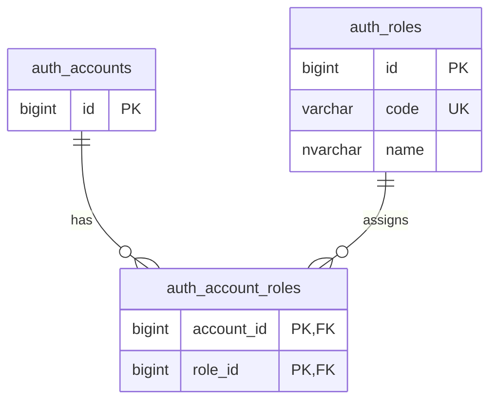

# Account, role catalog and membership

The three-table model approved 03 November 2026:

| Table | Columns | Constraints |
|---|---|---|
| `auth_accounts` | Existing account fields, `id` | Existing PK; legacy `role` retained temporarily as non-authoritative projection |
| `auth_roles` | `id BIGINT`, `code VARCHAR(20)`, `name NVARCHAR(100)` | PK(id), UNIQUE(code), approved-code CHECK |
| `auth_account_roles` | `account_id BIGINT`, `role_id BIGINT` | PK(account_id,role_id), FK→auth_accounts.id, FK→auth_roles.id |

Catalog: 1 ADMIN / Quản trị viên; 2 OWNER / Chủ cho thuê; 3 CUSTOMER / Người tìm thuê. An Owner has links to OWNER and CUSTOMER. Admin is not automatically granted ordinary rental capabilities. Whether to introduce TENANT into the catalog is deferred; current tenant access still follows exact contract parties/status.

V50 initializes memberships from the old single-role data once. V52 preserves that exact set, replacing the intermediate string column with role_id. Both can be replayed after upgrade without restoring revoked roles. They are in the startup list in order; no dependency on another task's V51. Stop old backend writers before deployment, preserve backups and deploy the corresponding backend. No live DB migration is performed by this PR update.

Catalog entity is immutable and shared, with no cascade persist/remove from account. Display-name changes or adding roles are not exposed through a new public endpoint. API/JWT continue returning code arrays, so this follow-up requires no UI response-shape change. The retained account.role column is not a fourth relationship or an authorization source.

`tools/verify-account-roles.ps1` delegates to `verify-role-catalog.ps1`. It reuses the existing dedicated `ancu_account_roles_20261103` test database. It never creates/resets a database or accepts proptech_db. Upgrade/replay checks compare effective code memberships and account/contract fingerprints. A transactional temporary rename tests the fresh-initialization path and rolls back; no additional test database is needed.
