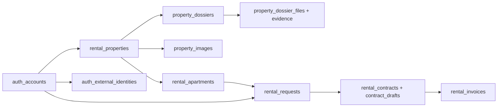

# Giải thích database An Cư PropTech

**Ngày đối chiếu:** 28/10/2026. **Nguồn:** schema thực tế SQL Server `proptech_db`, các model JPA và migration V1–V19.

Database hiện có **29 bảng**, **16 cột BIGINT IDENTITY**; không còn cột kiểu SQL `uniqueidentifier`. Bảng phụ dùng chung khóa của bảng gốc hoặc khóa ghép sẽ không có IDENTITY riêng. Dữ liệu văn bản trong archive/snapshot cũ vẫn giữ nguyên.

## Bổ sung F07/F08 — migration V20/V21

Phần 29 bảng bên dưới là ảnh chụp live tại V19. Đợt này chỉ chạy trên SQL clone; live áp dụng khi khởi động lại Backend. Không tạo lại database hoặc đổi khóa chính cũ.

| Bảng / cột mới | Lưu gì, dùng để làm gì? |
|---|---|
| `property_external_imports.bank/account_number/account_holder_name` | Tài khoản nhận tiền chủ tài sản nguồn khai báo; chỉ Owner/quyền đọc hợp đồng chính xác được xem, không đưa lên catalog. Không phải kết quả xác minh ngân hàng. |
| `property_external_imports.receiving_account_updated_at/version` | Thời điểm cập nhật và optimistic version để không ghi đè dữ liệu nhận tiền cũ. Snapshot Auth0 gốc không sửa. |
| `auth_accounts.local_password_enabled` | Có cho đăng nhập bằng mật khẩu nội bộ không. Cờ mới mặc định giữ quyền đăng nhập cũ nếu có hash; không suy đoán hash Google là ngẫu nhiên hay đã thay thủ công. Google mới/null hash chưa bật; thiết lập mật khẩu thành công thì bật. Không phải xác thực email/CCCD. |
| `auth_accounts.google_subject` nếu chưa có | Bổ sung cột phục vụ model Google hiện tại trước khi chạy V21. Không giải quyết unique/index của F10 trong đợt này. |
| `account_reauthentications` | Bảng mới cho challenge/quyền xác thực lại một lần. `id` BIGINT IDENTITY; `account_id/session_id` FK; `account_version/purpose` ràng buộc lệnh; `nonce_hash/credential_hash/proof_hash` chỉ hash; `created_at/expires_at/confirmed_at/used_at/attempts` quản lý thời hạn/lần thử. Không lưu token provider, OTP hoặc mật khẩu. |

Sau hai migration, schema thiết kế có thêm 1 bảng và 1 cột IDENTITY so với ảnh chụp V19. Existing contract JSON giữ nguyên; hợp đồng mới có `snapshot.evidence` thể hiện nguồn xác thực. Tài sản vẫn dùng chung `rental_properties/rental_apartments`; chỉ bằng chứng Admin/Auth0 lưu riêng theo bản chất nguồn.

## Bổ sung V22 — consent đọc tài sản độc lập với quyền Owner

`property_source_consents` là bảng mới, dùng `account_id` BIGINT làm PK/FK chung với account (không phải một ID UUID hoặc root entity có IDENTITY riêng). Lưu `issuer`, `subject`, `consented_at`, `consent_version` để giới hạn quyền đọc đúng nguồn của chính tài khoản. Không lưu danh sách tài sản, JWT, mật khẩu hoặc M2M secret và không cấp Owner khi ghi consent.

`auth_owner_upgrades` cũ giữ nguyên dữ liệu audit; luồng mới không dùng việc đồng ý/số lượng preview để nâng quyền. Owner mới được ghi cùng transaction tạo tài sản nguồn hợp lệ hoặc khi Admin duyệt hồ sơ thủ công đầu tiên. `rental_properties.version` cũng tăng khi thay gallery để chống cập nhật mất dữ liệu; không thêm bảng ảnh thứ hai. Không thay hợp đồng, khóa chính hoặc trạng thái thuê có sẵn. V22 chỉ áp dụng live khi restart Backend; phiên triển khai đã chạy trên SQL clone.

## 1. Phân biệt các trạng thái xác thực

| Vị trí | Ý nghĩa | Có xác thực CCCD không? |
|---|---|---|
| `auth_accounts.contact_verified` | Cờ tổng hợp xác thực liên hệ của luồng cũ | Không. Không được dùng cột này để kết luận đã xác thực CCCD |
| `auth_accounts.email_verified` | Đã hoàn tất xác thực email trong hệ thống | Không |
| `auth_accounts.phone_verified` | Trạng thái xác thực số điện thoại; chưa có tích hợp SMS | Không |
| `auth_accounts.identity_verified` | **Cột mới**, summary danh tính; backfill/cập nhật từ bằng chứng Auth0 VERIFIED | Có theo luồng VNeID mô phỏng, không phải kết nối VNeID thật |
| `auth_external_identities.verification_status` | Bằng chứng danh tính có nguồn, issuer, subject và thời điểm | **Nguồn kiểm tra chính** của các điều kiện VNeID |
| `account_identity_profiles.verification_status` | Trạng thái hồ sơ CCCD tự khai/tải ảnh cũ | Hồ sơ tự khai vẫn NOT_VERIFIED, không thay bằng chứng Auth0 |
| `auth_accounts.status` | Trạng thái sử dụng tài khoản: PENDING_VERIFICATION/ACTIVE/LOCKED/INACTIVE | ACTIVE không tự chứng minh danh tính |
| `rental_properties.approval_status` | Tài sản đã qua luồng duyệt nào/chưa | Không xác thực lại danh tính cá nhân |

Frontend không được gửi `identity_verified=true`. Backend vẫn kiểm tra bằng chứng VERIFIED ở bảng riêng; email claim từ Auth0 không tự trở thành `email_verified`. `role=OWNER` mở chức năng quản lý, không có nghĩa mọi tài sản của người đó đã được duyệt hoặc quyền cho thuê còn hạn.

## 2. Tài khoản và bảo mật — 6 bảng

| Bảng | Lưu dữ liệu gì? | Chức năng và quan hệ |
|---|---|---|
| `auth_accounts` | Email, password hash, tên/liên hệ, role, status, các cờ xác thực và version | Tài khoản gốc. IDENTITY sinh ID; không lưu mật khẩu dạng rõ. Chủ tài sản và người thuê đều tham chiếu bảng này |
| `auth_sessions` | Account, thời điểm hết hạn/thu hồi phiên | Kiểm soát phiên đăng nhập; JWT nội bộ chứa ID tài khoản/phiên. Đăng xuất hoặc đổi thông tin nhạy cảm thu hồi phiên |
| `auth_refresh_tokens` | Session, token hash, thời điểm đã dùng | Xoay refresh token và phát hiện dùng lại. Token thật ở HttpOnly cookie, DB chỉ lưu hash |
| `email_change_challenges` | Account, email đích, mã OTP đã hash, thời hạn, số lần thử, used/invalidated và accountVersion | Đổi/xác thực email qua OTP. Không đổi email chính trước khi xác nhận thành công |
| `auth_external_identities` | Account, issuer/subject Auth0, CCCD/tên/ngày sinh/giới tính/địa chỉ, source, VERIFIED và verifiedAt | Bằng chứng VNeID mô phỏng. CCCD và cặp issuer/subject có ràng buộc duy nhất; dữ liệu cá nhân riêng tư |
| `auth_owner_upgrades` | Account, đồng ý truy cập nguồn, thông tin bằng chứng/tài sản đủ điều kiện và thời điểm nâng cấp | Audit nâng cấp chính chủ từ nguồn Auth0. Nhánh Admin duyệt ủy quyền/thuê lại có lịch sử ở dossier; không bắt buộc có bản ghi tại đây |

## 3. Hồ sơ căn cước tự khai — 2 bảng

| Bảng | Nội dung | Chức năng |
|---|---|---|
| `account_identity_profiles` | Họ tên, số giấy tờ, ngày sinh/cấp, nơi cấp, địa chỉ, trạng thái, version, localFixture | Hồ sơ tự khai cũ, đọc bởi chính tài khoản; có thể làm nguồn thông tin bản nháp nếu chưa có căn cước Auth0. Không tự biến thành VERIFIED |
| `account_identity_documents` | Bytes ảnh mặt trước/mặt sau và MIME | Chứa ảnh CCCD riêng tư, tách khỏi profile và ảnh quảng bá. PK là account_id dùng chung tài khoản; không sinh IDENTITY thứ hai |

## 4. Tài sản, căn cho thuê và hình ảnh — 5 bảng

| Bảng | Nội dung | Chức năng |
|---|---|---|
| `rental_properties` | Owner, tên/địa chỉ, SINGLE_UNIT/MULTI_UNIT, approvalStatus, loại quyền, thời hạn và approvedRightsDossierId | Đại diện tài sản/quyền khai thác. Một căn chung cư chính chủ không đồng nghĩa sở hữu cả tòa. Có thể chứa một hoặc nhiều căn cho thuê |
| `rental_apartments` | Property, mã căn, diện tích, giá thuê, đơn giá điện/nước, cọc/chỉ số công tơ, mô tả, publication/availability/version | Đơn vị thực sự được đăng, nhận yêu cầu và lập hợp đồng. Chỉ VACANT và không còn PENDING request mới sửa giá |
| `rental_apartment_amenities` | Apartment + tên tiện ích | Danh sách tiện ích của căn; bảng collection, không cần IDENTITY riêng |
| `property_external_imports` | Property, issuer/subject, mã tài sản ngoài, sourceVersion/hash, snapshot nguồn, importedAt | Bằng chứng import từ Auth0; chống import trùng và tránh tin tài sản do client tự khai. PK dùng property_id |
| `property_images` | Uploader, property nullable, thứ tự, MIME, thời điểm, bytes ảnh | **Bảng mới** cho 1–4 ảnh quảng bá mỗi tài sản. Chưa gắn tài sản là ảnh staging riêng tư; ảnh đầu làm đại diện. Khác hoàn toàn ảnh CCCD/chứng từ |

Ảnh JPEG/PNG đầu vào tối đa5MB/ảnh, tối đa20MP, được mã hóa lại PNG; lưu SQL `varbinary(max)`. Chưa duyệt/chưa đăng: chỉ người upload xem qua Bearer. Khi tài sản APPROVED có căn PUBLISHED và Owner ACTIVE: ảnh quảng bá được đọc công khai. Không công khai giấy tờ cùng ảnh quảng bá. Các căn trong cùng Property dùng chung bộ ảnh này.

## 5. Hồ sơ pháp lý và nhắc thời hạn — 5 bảng

| Bảng | Nội dung | Chức năng |
|---|---|---|
| `property_dossiers` | Property, loại quyền OWNERSHIP/AUTHORIZATION/SUBLEASE, thông tin người nộp/chủ gốc, ngân hàng nhận tiền, giấy chứng nhận, thời hạn, reviewer/lý do/status/version/renewal | Các lần nộp hồ sơ và kết quả Admin. Hồ sơ mới/gia hạn không sửa bản đã duyệt; quyền hiện hành chỉ thay sau khi duyệt hợp lệ |
| `property_evidence_files` | Metadata: property/uploader/purpose/tên file/MIME/dung lượng/thời điểm | Quản lý loại chứng từ: sở hữu, ủy quyền, hợp đồng gốc, đồng ý cho thuê lại, hỗ trợ...; kiểm tra giấy tờ đúng người/tài sản/loại |
| `property_evidence_content` | ID file + bytes | Nội dung PDF/JPEG/PNG riêng tư, PK dùng chung EvidenceFile. Tách metadata để không tải bytes khi liệt kê |
| `property_dossier_files` | Dossier + File | Liên kết giấy tờ với đúng lần nộp; Admin chỉ đọc file thuộc hồ sơ đã gửi. Không có IDENTITY riêng |
| `property_right_notices` | Property, recipient, dossier, EXPIRING/EXPIRED, ngày hết hạn, outbox email/attempt/retry/version | Thông báo trong app, chống trùng theo dossier+kind; email chỉ đến địa chỉ đã verified, có retry. Không phải email provider hoặc bằng chứng inbox đã nhận |

Ủy quyền cần giấy sở hữu gốc + giấy ủy quyền riêng. Thuê lại cần giấy sở hữu gốc + hợp đồng thuê gốc + văn bản đồng ý cho thuê lại riêng; không phân tích điều khoản trong PDF để thay văn bản riêng. Chứng từ tối đa10MB/file, khác giới hạn5MB của ảnh quảng bá.

## 6. Yêu cầu thuê và hợp đồng — 3 bảng

| Bảng | Nội dung | Chức năng |
|---|---|---|
| `rental_requests` | Apartment, Customer, lời nhắn, PENDING/ACCEPTED/REJECTED/CANCELLED, lý do/thời điểm/version, **quoted_monthly_rent** | Theo dõi yêu cầu. Giá snapshot mới lưu lúc gửi; các yêu cầu cũ không có snapshot giữ NULL. Còn PENDING thì khóa đổi giá căn hộ |
| `rental_contracts` | Apartment, Customer, DRAFT/ACTIVE/ENDED, ngày bắt đầu/kết thúc, đơn giá thuê/điện/nước và billingVersion | Hợp đồng/nguồn tính hóa đơn. Đơn giá đã thỏa thuận không thay khi Owner sửa giá quảng cáo sau này. Không tự kích hoạt hợp đồng |
| `contract_drafts` | Contract, request, snapshotJson, clausesJson, cọc/ngày/phương thức thanh toán/mục đích/contentVersion | Bản nháp riêng tư, các điều khoản và snapshot chốt tại lúc tạo. JSON cũ giữ UUID lịch sử để không viết lại nội dung hợp đồng; JSON mới chứa ID số dạng chuỗi |

Tenant là Customer có quan hệ qua hợp đồng, không phải role mới. Owner vẫn thuê tài sản của người khác và giữ lịch sử của mình; không tự thuê căn hộ mình sở hữu/quản lý.

## 7. Hóa đơn và module ký quỹ cũ — 3 bảng

| Bảng | Nội dung | Chức năng |
|---|---|---|
| `rental_invoices` | Contract, kỳ, chỉ số đầu/cuối, đơn giá/thành tiền, hạn trả, DRAFT/SENT và version | Tính điện nước/tiền thuê theo hợp đồng, không theo giá niêm yết mới. Chống trùng kỳ và chỉ số giảm; DRAFT riêng Owner, SENT mới đến đúng người thuê |
| `invoice_notifications` | Invoice, Customer, thời điểm | Thông báo hóa đơn đến đúng người; tránh gửi lặp theo quy tắc hiện có |
| `escrow_deposits` | Mã hợp đồng/phòng kiểu văn bản của module cũ, người liên quan, số tiền/trạng thái/mốc thời gian/reference | Module TrustGuard/ký quỹ cũ, tách khỏi hợp đồng REST mới. ID bản ghi đã chuyển IDENTITY; contract_id/room_id vẫn là reference văn bản legacy, chưa phải FK tích hợp thanh toán thật |

## 8. Archive và bảng hỗ trợ chuyển ID — 5 bảng

| Bảng | Lưu gì và dùng để làm gì? |
|---|---|
| `legacy_rooms_archive` | Bản lưu dữ liệu phòng/tòa từ mô hình cũ; giữ để truy vết lần chuyển Room → Apartment. Không phải inventory đang phục vụ API |
| `legacy_room_amenities_archive` | Tiện ích phòng của dữ liệu cũ; giữ nguyên reference văn bản |
| `legacy_tenants_archive` | Dữ liệu người thuê của mô hình cũ; không tự trở thành tài khoản/tenant hiện hành |
| `legacy_invoices_archive` | Hóa đơn cũ trước mô hình hóa đơn theo hợp đồng; không dùng để sinh hóa đơn mới |
| `legacy_id_mappings` | entity_name + legacy_id → numeric_id cho các bản ghi đã tồn tại khi chuyển. Có khóa ghép/unique; phục vụ đối chiếu, không đưa UUID trở lại làm khóa model. Hiện đã giữ692 ánh xạ tại thời điểm migration |

## 9. Cách các bảng nối với nhau

Các liên kết cấp quyền phải kiểm tra trên Backend theo tài khoản/đối tượng cụ thể; ID tăng dần không được coi là cơ chế bảo mật. Thông tin CCCD, password/token/OTP hash, ảnh giấy tờ, ngân hàng và snapshot nguồn không phải dữ liệu tin đăng công khai.

## 10. Sau chuyển ID cần lưu ý

- ID khóa model là BIGINT IDENTITY; API gửi ID dưới dạng **chuỗi số**, ví dụ `"123"`, để JavaScript không mất chính xác. Version là số.
- IDENTITY có thể có khoảng trống; số được backfill cho dữ liệu cũ không phải mốc ngày tạo. Không dùng ID để suy ra độ mới hoặc thay quy tắc xếp yêu cầu theo createdAt.
- Bảng phụ dùng account_id/property_id/file_id hoặc khóa ghép kế thừa ID gốc; không tạo IDENTITY thừa.
- Chuyển đã giữ số bản ghi, các fingerprint dữ liệu nhạy cảm được kiểm tra, index/unique/FK; hiện không có FK bị disable hoặc untrusted. Backup COPY_ONLY đã VERIFYONLY trước khi áp dụng; không reset tài khoản/mật khẩu.
- Cần đăng nhập lại. Phiên cũ bị thu hồi và OTP đổi email còn chờ bị vô hiệu để không dùng JWT/HMAC với ID đã đổi. Bookmark URL UUID cũ phải mở lại từ danh sách mới.
- Không xóa archive/snapshot hoặc đổi ID nằm trong JSON hợp đồng cũ. UUID JTI/ngẫu nhiên của bảo mật vẫn có thể tồn tại; đó không phải khóa model.
- Một số script/e2e fixture lịch sử còn giả định UUID hoặc vai trò đăng ký cũ; chúng không phải luồng ứng dụng hiện tại và chưa được nghiệm thu lại trong lần này. Bộ kiểm thử mới dùng IDENTITY và database bản sao riêng, không dùng các script lịch sử để sửa dữ liệu đang chạy.

Phần phụ lục bên dưới được sinh từ metadata SQL thực tế, không chứa bản ghi cá nhân hay credentials.

## Phụ lục: các cột đang có trong SQL Server

<strong>account_identity_documents</strong> — danh sách cột

| Cột | Kiểu SQL | NULL | IDENTITY |
|---|---|---|---|
| `front_content` | `varbinary(max)` | Có | — |
| `front_content_type` | `varchar(30)` | Không | — |
| `back_content` | `varbinary(max)` | Có | — |
| `back_content_type` | `varchar(30)` | Không | — |
| `account_id` | `bigint` | Không | — |

<strong>account_identity_profiles</strong> — danh sách cột

| Cột | Kiểu SQL | NULL | IDENTITY |
|---|---|---|---|
| `legal_name` | `nvarchar(100)` | Không | — |
| `document_number` | `varchar(12)` | Không | — |
| `date_of_birth` | `date` | Không | — |
| `issue_date` | `date` | Không | — |
| `issue_place` | `nvarchar(200)` | Không | — |
| `permanent_address` | `nvarchar(500)` | Không | — |
| `current_address` | `nvarchar(500)` | Không | — |
| `verification_status` | `varchar(24)` | Không | — |
| `updated_at` | `datetime2` | Không | — |
| `version` | `bigint` | Không | — |
| `local_fixture` | `bit` | Không | — |
| `account_id` | `bigint` | Không | — |

<strong>auth_accounts</strong> — danh sách cột

| Cột | Kiểu SQL | NULL | IDENTITY |
|---|---|---|---|
| `email` | `varchar(254)` | Không | — |
| `password_hash` | `varchar(100)` | Có | — |
| `full_name` | `nvarchar(100)` | Không | — |
| `role` | `varchar(20)` | Không | — |
| `status` | `varchar(24)` | Không | — |
| `contact_verified` | `bit` | Không | — |
| `version` | `bigint` | Không | — |
| `phone` | `varchar(20)` | Có | — |
| `address` | `nvarchar(300)` | Có | — |
| `bio` | `nvarchar(1000)` | Có | — |
| `date_of_birth` | `date` | Có | — |
| `email_verified` | `bit` | Không | — |
| `phone_verified` | `bit` | Không | — |
| `identity_verified` | `bit` | Không | — |
| `id` | `bigint` | Không | Có |

<strong>auth_external_identities</strong> — danh sách cột

| Cột | Kiểu SQL | NULL | IDENTITY |
|---|---|---|---|
| `issuer` | `varchar(255)` | Không | — |
| `subject` | `varchar(255)` | Không | — |
| `document_number` | `varchar(12)` | Không | — |
| `legal_name` | `nvarchar(100)` | Không | — |
| `date_of_birth` | `date` | Không | — |
| `gender` | `nvarchar(30)` | Không | — |
| `address` | `nvarchar(300)` | Không | — |
| `source` | `varchar(40)` | Không | — |
| `verification_status` | `varchar(20)` | Không | — |
| `verified_at` | `datetimeoffset` | Có | — |
| `version` | `bigint` | Không | — |
| `account_id` | `bigint` | Không | — |

<strong>auth_owner_upgrades</strong> — danh sách cột

| Cột | Kiểu SQL | NULL | IDENTITY |
|---|---|---|---|
| `consented_at` | `datetimeoffset` | Có | — |
| `checked_at` | `datetimeoffset` | Có | — |
| `eligible_asset_count` | `int` | Không | — |
| `consent_version` | `varchar(40)` | Không | — |
| `source` | `varchar(40)` | Không | — |
| `account_id` | `bigint` | Không | — |

<strong>auth_refresh_tokens</strong> — danh sách cột

| Cột | Kiểu SQL | NULL | IDENTITY |
|---|---|---|---|
| `token_hash` | `varchar(64)` | Không | — |
| `used_at` | `datetime2` | Có | — |
| `id` | `bigint` | Không | Có |
| `session_id` | `bigint` | Không | — |

<strong>auth_sessions</strong> — danh sách cột

| Cột | Kiểu SQL | NULL | IDENTITY |
|---|---|---|---|
| `expires_at` | `datetime2` | Không | — |
| `revoked_at` | `datetime2` | Có | — |
| `id` | `bigint` | Không | Có |
| `account_id` | `bigint` | Không | — |

<strong>contract_drafts</strong> — danh sách cột

| Cột | Kiểu SQL | NULL | IDENTITY |
|---|---|---|---|
| `snapshot_json` | `nvarchar(max)` | Có | — |
| `clauses_json` | `nvarchar(max)` | Có | — |
| `deposit` | `decimal(15,2)` | Không | — |
| `payment_day` | `int` | Không | — |
| `payment_method` | `nvarchar(300)` | Không | — |
| `usage_purpose` | `nvarchar(300)` | Không | — |
| `created_at` | `datetime2` | Không | — |
| `content_version` | `bigint` | Không | — |
| `id` | `bigint` | Không | Có |
| `contract_id` | `bigint` | Không | — |
| `rental_request_id` | `bigint` | Không | — |

<strong>email_change_challenges</strong> — danh sách cột

| Cột | Kiểu SQL | NULL | IDENTITY |
|---|---|---|---|
| `target_email` | `varchar(254)` | Không | — |
| `code_hash` | `varchar(64)` | Không | — |
| `account_version` | `bigint` | Không | — |
| `attempts` | `int` | Không | — |
| `created_at` | `datetime2` | Không | — |
| `expires_at` | `datetime2` | Không | — |
| `used_at` | `datetime2` | Có | — |
| `invalidated_at` | `datetime2` | Có | — |
| `version` | `bigint` | Không | — |
| `id` | `bigint` | Không | Có |
| `account_id` | `bigint` | Không | — |

<strong>escrow_deposits</strong> — danh sách cột

| Cột | Kiểu SQL | NULL | IDENTITY |
|---|---|---|---|
| `amount` | `numeric(15,2)` | Có | — |
| `bank_hold_reference` | `varchar(50)` | Có | — |
| `contract_id` | `varchar(255)` | Không | — |
| `created_at` | `datetime2` | Có | — |
| `landlord_name` | `varchar(255)` | Có | — |
| `note` | `varchar(255)` | Có | — |
| `released_at` | `datetime2` | Có | — |
| `room_id` | `varchar(255)` | Không | — |
| `status` | `varchar(30)` | Có | — |
| `tenant_name` | `varchar(255)` | Có | — |
| `id` | `bigint` | Không | Có |

<strong>invoice_notifications</strong> — danh sách cột

| Cột | Kiểu SQL | NULL | IDENTITY |
|---|---|---|---|
| `created_at` | `datetime2` | Không | — |
| `id` | `bigint` | Không | Có |
| `customer_id` | `bigint` | Không | — |
| `invoice_id` | `bigint` | Không | — |

<strong>legacy_id_mappings</strong> — danh sách cột

| Cột | Kiểu SQL | NULL | IDENTITY |
|---|---|---|---|
| `entity_name` | `varchar(128)` | Không | — |
| `legacy_id` | `varchar(64)` | Không | — |
| `numeric_id` | `bigint` | Không | — |

<strong>legacy_invoices_archive</strong> — danh sách cột

| Cột | Kiểu SQL | NULL | IDENTITY |
|---|---|---|---|
| `id` | `varchar(255)` | Không | — |
| `due_date` | `date` | Có | — |
| `electric_new` | `int` | Có | — |
| `electric_old` | `int` | Có | — |
| `electric_price` | `numeric(38,2)` | Có | — |
| `electric_total` | `numeric(38,2)` | Có | — |
| `is_paid` | `bit` | Có | — |
| `month` | `varchar(255)` | Có | — |
| `paid_at` | `date` | Có | — |
| `room_charge` | `numeric(38,2)` | Có | — |
| `room_id` | `varchar(255)` | Không | — |
| `service_fee` | `numeric(38,2)` | Có | — |
| `tenant_id` | `varchar(255)` | Có | — |
| `total_amount` | `numeric(38,2)` | Có | — |
| `viet_qr_code_url` | `varchar(255)` | Có | — |
| `water_new` | `int` | Có | — |
| `water_old` | `int` | Có | — |
| `water_price` | `numeric(38,2)` | Có | — |
| `water_total` | `numeric(38,2)` | Có | — |

<strong>legacy_room_amenities_archive</strong> — danh sách cột

| Cột | Kiểu SQL | NULL | IDENTITY |
|---|---|---|---|
| `room_id` | `varchar(255)` | Không | — |
| `amenities` | `varchar(255)` | Có | — |

<strong>legacy_rooms_archive</strong> — danh sách cột

| Cột | Kiểu SQL | NULL | IDENTITY |
|---|---|---|---|
| `id` | `varchar(255)` | Không | — |
| `area` | `float` | Có | — |
| `bathrooms` | `int` | Có | — |
| `bedrooms` | `int` | Có | — |
| `building_id` | `varchar(255)` | Không | — |
| `deposit` | `numeric(15,2)` | Có | — |
| `description` | `varchar(255)` | Có | — |
| `floor` | `int` | Có | — |
| `legal_document_code` | `varchar(255)` | Có | — |
| `pccc_cert_code` | `varchar(255)` | Có | — |
| `price` | `numeric(15,2)` | Có | — |
| `room_number` | `varchar(20)` | Không | — |
| `status` | `varchar(20)` | Có | — |
| `trust_score` | `int` | Có | — |
| `electricity_index` | `int` | Có | — |
| `max_occupants` | `int` | Có | — |
| `water_index` | `int` | Có | — |

<strong>legacy_tenants_archive</strong> — danh sách cột

| Cột | Kiểu SQL | NULL | IDENTITY |
|---|---|---|---|
| `id` | `varchar(255)` | Không | — |
| `birth_date` | `date` | Có | — |
| `current_room_id` | `varchar(255)` | Có | — |
| `e_kyc_verified` | `bit` | Có | — |
| `email` | `varchar(255)` | Có | — |
| `full_name` | `varchar(255)` | Không | — |
| `id_number` | `varchar(20)` | Có | — |
| `permanent_address` | `varchar(255)` | Có | — |
| `phone` | `varchar(15)` | Không | — |
| `temporary_residence_registered_at` | `date` | Có | — |

<strong>property_dossier_files</strong> — danh sách cột

| Cột | Kiểu SQL | NULL | IDENTITY |
|---|---|---|---|
| `dossier_id` | `bigint` | Không | — |
| `file_id` | `bigint` | Không | — |

<strong>property_dossiers</strong> — danh sách cột

| Cột | Kiểu SQL | NULL | IDENTITY |
|---|---|---|---|
| `right_type` | `varchar(24)` | Không | — |
| `applicant_name` | `nvarchar(100)` | Không | — |
| `bank` | `nvarchar(100)` | Không | — |
| `account_number` | `varchar(40)` | Không | — |
| `account_holder_name` | `nvarchar(100)` | Không | — |
| `status` | `varchar(24)` | Không | — |
| `submitted_at` | `datetime2` | Không | — |
| `reviewed_at` | `datetime2` | Có | — |
| `review_reason` | `nvarchar(2000)` | Có | — |
| `version` | `bigint` | Không | — |
| `certificate_number` | `nvarchar(100)` | Có | — |
| `certificate_issue_date` | `date` | Có | — |
| `certificate_issue_place` | `nvarchar(200)` | Có | — |
| `exploitation_right_description` | `nvarchar(1000)` | Có | — |
| `local_fixture` | `bit` | Không | — |
| `rights_valid_from` | `date` | Có | — |
| `rights_valid_until` | `date` | Có | — |
| `original_lease_from` | `date` | Có | — |
| `original_lease_until` | `date` | Có | — |
| `principal_name` | `nvarchar(100)` | Có | — |
| `principal_document_number` | `varchar(12)` | Có | — |
| `applicant_document_number` | `varchar(12)` | Có | — |
| `renewal` | `bit` | Không | — |
| `id` | `bigint` | Không | Có |
| `property_id` | `bigint` | Không | — |
| `reviewer_id` | `bigint` | Có | — |

<strong>property_evidence_content</strong> — danh sách cột

| Cột | Kiểu SQL | NULL | IDENTITY |
|---|---|---|---|
| `content` | `varbinary(max)` | Có | — |
| `id` | `bigint` | Không | — |

<strong>property_evidence_files</strong> — danh sách cột

| Cột | Kiểu SQL | NULL | IDENTITY |
|---|---|---|---|
| `purpose` | `varchar(24)` | Không | — |
| `filename` | `nvarchar(150)` | Không | — |
| `content_type` | `varchar(50)` | Không | — |
| `size_bytes` | `bigint` | Không | — |
| `created_at` | `datetime2` | Không | — |
| `id` | `bigint` | Không | Có |
| `property_id` | `bigint` | Không | — |
| `uploader_id` | `bigint` | Không | — |

<strong>property_external_imports</strong> — danh sách cột

| Cột | Kiểu SQL | NULL | IDENTITY |
|---|---|---|---|
| `issuer` | `varchar(300)` | Không | — |
| `external_asset_id` | `nvarchar(100)` | Không | — |
| `subject` | `varchar(255)` | Không | — |
| `source` | `varchar(40)` | Không | — |
| `source_version` | `varchar(64)` | Không | — |
| `source_snapshot` | `nvarchar(max)` | Có | — |
| `imported_at` | `datetime2` | Không | — |
| `property_id` | `bigint` | Không | — |

<strong>property_images</strong> — danh sách cột

| Cột | Kiểu SQL | NULL | IDENTITY |
|---|---|---|---|
| `position` | `int` | Không | — |
| `content_type` | `varchar(255)` | Không | — |
| `created_at` | `datetimeoffset` | Có | — |
| `content` | `varbinary(max)` | Có | — |
| `id` | `bigint` | Không | Có |
| `property_id` | `bigint` | Có | — |
| `uploader_id` | `bigint` | Không | — |

<strong>property_right_notices</strong> — danh sách cột

| Cột | Kiểu SQL | NULL | IDENTITY |
|---|---|---|---|
| `kind` | `varchar(16)` | Không | — |
| `expires_on` | `date` | Không | — |
| `created_at` | `datetime2` | Không | — |
| `email_status` | `varchar(16)` | Không | — |
| `email_destination` | `nvarchar(254)` | Có | — |
| `attempts` | `int` | Không | — |
| `next_attempt_at` | `datetime2` | Không | — |
| `version` | `bigint` | Không | — |
| `id` | `bigint` | Không | Có |
| `dossier_id` | `bigint` | Không | — |
| `property_id` | `bigint` | Không | — |
| `recipient_id` | `bigint` | Không | — |

<strong>rental_apartment_amenities</strong> — danh sách cột

| Cột | Kiểu SQL | NULL | IDENTITY |
|---|---|---|---|
| `amenity` | `nvarchar(100)` | Có | — |
| `apartment_id` | `bigint` | Không | — |

<strong>rental_apartments</strong> — danh sách cột

| Cột | Kiểu SQL | NULL | IDENTITY |
|---|---|---|---|
| `title` | `nvarchar(150)` | Không | — |
| `description` | `nvarchar(3000)` | Không | — |
| `area_m2` | `decimal(12,2)` | Không | — |
| `advertised_monthly_rent` | `decimal(15,2)` | Không | — |
| `bedrooms` | `int` | Có | — |
| `bathrooms` | `int` | Có | — |
| `cover_image_path` | `varchar(500)` | Có | — |
| `publication_status` | `varchar(24)` | Không | — |
| `availability` | `varchar(24)` | Không | — |
| `created_at` | `datetime2` | Không | — |
| `version` | `bigint` | Không | — |
| `room_number` | `nvarchar(20)` | Có | — |
| `floor` | `int` | Có | — |
| `deposit` | `decimal(15,2)` | Có | — |
| `electricity_index` | `int` | Có | — |
| `water_index` | `int` | Có | — |
| `max_occupants` | `int` | Có | — |
| `electricity_unit_price` | `decimal(15,2)` | Có | — |
| `water_unit_price` | `decimal(15,2)` | Có | — |
| `id` | `bigint` | Không | Có |
| `property_id` | `bigint` | Không | — |

<strong>rental_contracts</strong> — danh sách cột

| Cột | Kiểu SQL | NULL | IDENTITY |
|---|---|---|---|
| `status` | `varchar(24)` | Không | — |
| `start_date` | `date` | Không | — |
| `end_date` | `date` | Không | — |
| `monthly_rent` | `decimal(15,2)` | Không | — |
| `electricity_unit_price` | `decimal(15,2)` | Không | — |
| `water_unit_price` | `decimal(15,2)` | Không | — |
| `electricity_baseline` | `decimal(15,2)` | Có | — |
| `water_baseline` | `decimal(15,2)` | Có | — |
| `baseline_date` | `date` | Có | — |
| `billing_version` | `bigint` | Không | — |
| `local_fixture` | `bit` | Không | — |
| `version` | `bigint` | Không | — |
| `id` | `bigint` | Không | Có |
| `apartment_id` | `bigint` | Không | — |
| `customer_id` | `bigint` | Không | — |

<strong>rental_invoices</strong> — danh sách cột

| Cột | Kiểu SQL | NULL | IDENTITY |
|---|---|---|---|
| `period` | `varchar(7)` | Không | — |
| `due_date` | `date` | Không | — |
| `monthly_rent` | `decimal(15,2)` | Không | — |
| `electricity_start_reading` | `decimal(15,2)` | Không | — |
| `electricity_end_reading` | `decimal(15,2)` | Không | — |
| `electricity_quantity` | `decimal(15,2)` | Không | — |
| `electricity_unit_price` | `decimal(15,2)` | Không | — |
| `electricity_amount` | `decimal(30,4)` | Không | — |
| `water_start_reading` | `decimal(15,2)` | Không | — |
| `water_end_reading` | `decimal(15,2)` | Không | — |
| `water_quantity` | `decimal(15,2)` | Không | — |
| `water_unit_price` | `decimal(15,2)` | Không | — |
| `water_amount` | `decimal(30,4)` | Không | — |
| `total_amount` | `decimal(31,4)` | Không | — |
| `status` | `varchar(16)` | Không | — |
| `created_at` | `datetime2` | Không | — |
| `sent_at` | `datetime2` | Có | — |
| `version` | `bigint` | Không | — |
| `id` | `bigint` | Không | Có |
| `contract_id` | `bigint` | Không | — |

<strong>rental_properties</strong> — danh sách cột

| Cột | Kiểu SQL | NULL | IDENTITY |
|---|---|---|---|
| `name` | `nvarchar(150)` | Không | — |
| `address` | `nvarchar(300)` | Không | — |
| `city` | `nvarchar(80)` | Không | — |
| `district` | `nvarchar(80)` | Không | — |
| `approval_status` | `varchar(24)` | Không | — |
| `version` | `bigint` | Không | — |
| `ward` | `nvarchar(80)` | Có | — |
| `rental_mode` | `varchar(24)` | Có | — |
| `onboarding_application` | `bit` | Không | — |
| `right_type` | `varchar(24)` | Có | — |
| `rights_valid_from` | `date` | Có | — |
| `rights_valid_until` | `date` | Có | — |
| `id` | `bigint` | Không | Có |
| `approved_rights_dossier_id` | `bigint` | Có | — |
| `owner_id` | `bigint` | Không | — |

<strong>rental_requests</strong> — danh sách cột

| Cột | Kiểu SQL | NULL | IDENTITY |
|---|---|---|---|
| `message` | `nvarchar(2000)` | Không | — |
| `status` | `varchar(24)` | Không | — |
| `created_at` | `datetime2` | Không | — |
| `version` | `bigint` | Không | — |
| `decision_reason` | `nvarchar(2000)` | Có | — |
| `quoted_monthly_rent` | `decimal(15,2)` | Có | — |
| `id` | `bigint` | Không | Có |
| `apartment_id` | `bigint` | Không | — |
| `customer_id` | `bigint` | Không | — |

